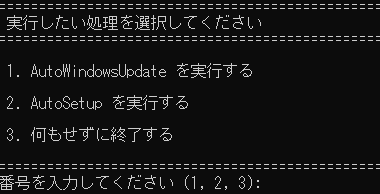
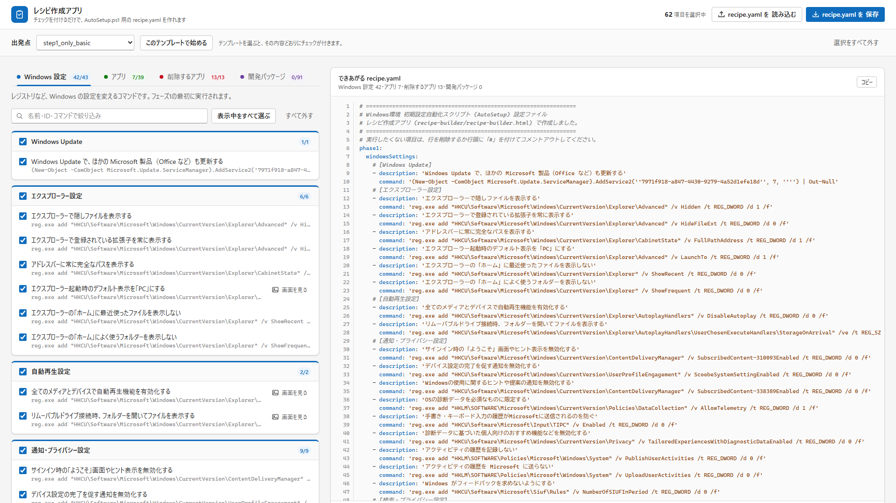

# Windows PC キッティング自動化スクリプト

Windows 11 PC のキッティング（初期セットアップ）から開発環境の構築までを自動化する PowerShell スクリプト集です。

**`recipe.yaml`** にやりたいことを書き、**`Start-Admin.bat`** を管理者として実行するだけで、手作業で時間のかかるセットアップを大きく減らし、誰がやっても同じ環境をすばやく作れます。`recipe.yaml` は、ブラウザーで開く **レシピ作成アプリ** を使えば、チェックを付けるだけで作れます。

<p align="center">

</p>

## 主な機能

- **Windows Update の全自動化**: 更新がなくなるまで、確認・インストール・再起動を無人で繰り返します。失敗し続ける更新があっても、上限の周回数で止まります。
- **アプリの一括インストールと削除**: `winget` で、`recipe.yaml` に書いたアプリをまとめてインストールし、不要なプリインストールアプリを削除します。最後に、インストール済みのアプリをすべて更新します。
- **Windows の設定変更**: エクスプローラーで拡張子を表示するなどの設定を `recipe.yaml` に書くだけで、スクリプトを編集せずに変えられます。
- **開発環境の自動構築**: VS Code 拡張機能、`npm`、`pip` などのパッケージマネージャーを通じて、開発用のパッケージをまとめてインストールします。
- **再起動を挟んだ 2 フェーズ実行**: アプリのインストール（フェーズ 1）と、PATH 環境変数を使う開発ツールの導入（フェーズ 2）の間に再起動を挟みます。インストールしたばかりのコマンドが見つからない、という失敗を防ぎます。
- **レシピ作成アプリ**: YAML を手で書かなくても、ブラウザーでチェックを付けるだけで `recipe.yaml` を作れます。
- **失敗を見逃さない結果表示**: 失敗した項目は最後に一覧で表示し、ログファイルにも残します。

## 動作環境

- Windows 11
- PowerShell 5.1 または PowerShell 7
  - `Start-Admin.bat` は、PowerShell 7（`pwsh.exe`）が入っていれば 7 で、なければ 5.1 でスクリプトを動かします。5.1 は非推奨になったため、7 を優先しています。
  - 5.1 で始めた場合も、再起動のときに 7 が入っていれば、再起動のあとは 7 で続けます（例：AutoSetup のフェーズ 1 で 7 を入れると、フェーズ 2 は 7 で動きます）。
- 管理者権限
  - PC を使うアカウントでサインインし、そのまま「管理者として実行」してください。
  - 別の管理者アカウントのパスワードを入れて実行すると、設定の一部がそのアカウントに入り、フェーズ 2 も自動で始まりません。
- インターネット接続

## 推奨ワークフロー

1. **OS のクリーンインストール**: Windows 11 をクリーンインストールします。
2. **リポジトリの配置**: このリポジトリをダウンロードし、フォルダーを PC の好きな場所（例: `C:\Users`）に置きます。USB メモリや外付けストレージから実行しても、基本的には問題ありません（[実行場所ごとの注意点](#実行場所ごとの注意点) を参照）。
3. **`recipe.yaml` の準備**: 次のどちらかの方法で、やりたいことを決めます。
   - [レシピ作成アプリ](#レシピ作成アプリ) でチェックを付けて保存し、リポジトリ直下の `recipe.yaml` と置き換えます。
   - `recipe.yaml` をテキストエディターで開き、不要な項目の行頭に `#` を付けてコメントアウトします。
4. **スクリプトの実行**:
   1. `Start-Admin.bat` を **右クリック** し、「**管理者として実行**」を選びます。
   2. メニューから `1. AutoWindowsUpdate` を選び、OS を最新の状態にします（**強く推奨**）。再起動のたびに、サインインすると続きが自動で始まります。
   3. 終わったら、もう一度 `Start-Admin.bat` を管理者として実行します。
   4. メニューから `2. AutoSetup` を選び、アプリのインストールと環境構築を始めます。フェーズ 1 のあと自動で再起動し、サインインするとフェーズ 2 が始まります。
5. **最終確認**:
   - 画面の結果まとめに、失敗した項目がないか確認します。失敗があれば、[ログファイル](#ログと結果の確認) で原因を確認します。
   - PC を一度、手動で再起動します。
   - Windows Update の画面やデバイスマネージャーを開き、更新漏れや不明なデバイスがないか確認します。

## スクリプト構成

| ファイル名 | 役割 |
|---|---|
| `Start-Admin.bat` | **入口となるファイル。** 管理者権限を確認し、実行するスクリプトをメニューから選ばせます。 |
| `AutoWindowsUpdate.ps1` | Windows Update を全自動で実行します。更新がなくなるまで、確認・インストール・再起動を繰り返します。失敗し続ける更新で止まらなくなるのを防ぐため、10 周で中断します。同じ更新が 2 周続けてインストールに失敗した場合も、その時点で中断します。 |
| `AutoSetup.ps1` | `recipe.yaml` に従って、Windows の設定変更、アプリのインストールと削除、開発環境の構築を、再起動を挟んだ 2 フェーズで実行します。 |
| `recipe.yaml` | **カスタマイズの中心。** インストールするアプリ、Windows の設定、開発パッケージなどを、コメント付きで定義します。 |
| `template-recipes/` | `recipe.yaml` のテンプレート集です。目的別の構成例をフォルダーごとに置いています。 |
| `APP_RecipeBuilder/recipe-builder.html` | **レシピ作成アプリ。** ブラウザーで開き、チェックを付けて `recipe.yaml` を作れます。ネット接続は不要です。 |
| `APP_RecipeBuilder/Update-RecipeBuilder.ps1` | `recipe.yaml` と `template-recipes/` の中身を、レシピ作成アプリに埋め込み直します。 |
| `APP_RecipeBuilder/images/` | レシピ作成アプリの「画面を見る」で表示する、Windows の設定画面の画像です。 |
| `キッティング手順.pdf` | キッティング全体の手順書です。図と画面写真で、再インストールから最終確認までを説明します。 |
| `AutoSetup未対応の設定手順チートシート/` | スクリプトで自動化していない設定の手順書です（例: Hyper-V、WSL2 のセットアップ）。 |
| `.github/workflows/lint.yml` | GitHub Actions の自動チェックです。スクリプトは実行せず、PowerShell 5.1 / 7 での構文チェック、PSScriptAnalyzer による書き方チェック、`recipe.yaml` の書式チェック、レシピ作成アプリの埋め込みが最新かのチェック、文字コードと改行のチェックを行います。 |
| `.github/scripts/Test-Recipe.ps1` | `recipe.yaml` と `template-recipes/` の書式チェックです。書き間違えたキーや、必須キーの抜けを見つけます。手元でも、`powershell-yaml` を入れた PowerShell で実行できます。 |
| `.github/scripts/Test-Encoding.ps1` | 文字コードと改行のチェックです。`.ps1` は BOM 付き UTF-8 と CRLF、`.bat` は Shift-JIS と CRLF、`.sh` は BOM なし UTF-8 と LF になっているかなどを確かめます。手元でも実行できます。 |

## カスタマイズ

セットアップの内容は、`recipe.yaml` を編集して自由に変えられます。不要な項目は、行頭に `#` を付けてコメントアウトしてください。

### レシピ作成アプリ

YAML を手で書かずに `recipe.yaml` を作りたい場合は、`APP_RecipeBuilder/recipe-builder.html` をダブルクリックして、ブラウザーで開きます。

<p align="center">

</p>

- 「Windows 設定」「アプリ」「削除するアプリ」「開発パッケージ」のタブで、入れたい項目にチェックを付けます。右側に、できあがる `recipe.yaml` がその場で表示されます。
- 「出発点」でテンプレートを選ぶと、その場でテンプレートの内容どおりにチェックが付きます。チェックを変えた後に、選んでいるテンプレートの状態へ戻したいときは「テンプレートの状態に戻す」を押します。どちらも、通知の「元に戻す」で前の選択に戻せます。「recipe.yaml を読み込む」で、手元の `recipe.yaml` を読み込んで続きを編集することもできます。
- 一覧の上には、選んだテンプレート（または読み込んだ `recipe.yaml`）に書かれている項目だけが、ファイルと同じ順番・見出しで並びます。何も変えずに保存すれば、元のファイルと同じ項目・同じ順番の `recipe.yaml` になります。ほかのテンプレートにしかない項目は、その下の「ほかのテンプレートにある項目」に並び、チェックを付けたものだけが `recipe.yaml` に入ります。
- `recipe.yaml` で `#` を付けてコメントアウトした項目は、チェックの付いていない項目として表示されます。逆に、チェックを外した項目は、保存する `recipe.yaml` にコメントアウトした形で残ります。あとから有効にするときは、その項目の各行の先頭にある `# `（`#` と、その後ろの空白1つ）を消します。
- 「すべて選択」「選択をすべて外す」で、すべてのタブのチェックをまとめて付けたり外したりできます。各タブの「表示中をすべて選ぶ」「すべて外す」は、そのタブの中だけが対象です。
- 一覧にない項目は、各タブの「一覧にない項目を追加する」から追加できます。
- 「Windows 設定」タブの項目のうち、設定画面に当たる場所があるものは、「画面を見る」で、その設定が表示される Windows の画面を確かめられます。画像は撮影した PC の画面の例なので、お使いの PC とは状態が違う場合があります。アプリを別の場所にコピーするときは、`images` フォルダーも一緒にコピーしてください。
- 「recipe.yaml を保存」で保存した `recipe.yaml` を、`AutoSetup.ps1` と同じフォルダーに置いて使います。

`recipe.yaml` や `template-recipes/` を変更したときは、次のコマンドでアプリの一覧を更新してください。

```powershell
.\APP_RecipeBuilder\Update-RecipeBuilder.ps1
```

### フェーズ 1 (`phase1`)

再起動の前に実行する、基本的なセットアップを定義します。上から順に、次の処理を行います。

- `windowsSettings`: Windows の設定を変えるコマンドを、`description`（説明）と `command`（実行するコマンド）で定義します。レジストリの変更などに使います。
- `wingetInstall`: `winget` でインストールするアプリの `id` と、必要に応じてインストールオプション（`options`）を書きます。
- `appxRemove`: 削除したい Windows 標準アプリの名前を書きます（ワイルドカード `*` を使えます）。

この 3 つのあと、`winget` でインストール済みのアプリをすべて更新し、フェーズ 2 を自動で始めるよう設定して再起動します。

### フェーズ 2 (`phase2`)

再起動の後に実行する、開発者向けパッケージのインストールを定義します。

- `packageManagers`: パッケージマネージャーを、リスト形式で複数定義できます。
  - `managerName`: ログに表示する名前です（例: `'npm'`、`'pip'`）。
  - `checkCommand`: パッケージがインストール済みかを確認するコマンドです。`{package}` はパッケージ名に置き換わります。終了コードが 0 以外になるか、エラーが出たときは「未インストール」とみなします（`Get-Command` などの PowerShell コマンドもそのまま使えます）。
  - `installCommand`: パッケージをインストールするコマンドです。`{package}` が置き換わります。
  - `packages`: このマネージャーでインストールするパッケージの一覧です。

リポジトリ直下の `recipe.yaml` では、フェーズ 2 は空（`packageManagers: []`）になっています。次の例は、`template-recipes/step2_VSCode/recipe.yaml` の一部です。

**設定例（VS Code 拡張機能）:**
```yaml
phase2:
  packageManagers:
    - managerName: 'vscode'
      checkCommand: 'if (-not (code --list-extensions | Where-Object { $_ -eq ''{package}'' })) { throw ''未インストール'' }'
      installCommand: 'code --install-extension {package}'
      packages:
        # 拡張パックに入っている拡張でも、使うものは1つずつ書く。パックの中身は作者の都合で変わることがあるため。
        # [表示]
        - description: '画面の日本語化'
          name: ms-ceintl.vscode-language-pack-ja
        - description: 'インデントの深さ別の色分け'
          name: oderwat.indent-rainbow
        - description: '全角スペースの強調表示'
          name: mosapride.zenkaku
        - description: 'コメントの種類別の色分け（TODO・注意など）'
          name: aaron-bond.better-comments
        - description: 'エラー・警告を行の横に表示'
          name: usernamehw.errorlens
        # [編集の補助]
        - description: 'EditorConfig（インデントや改行の書式をファイルでそろえる）'
          name: EditorConfig.EditorConfig
        - description: 'ファイル パスの入力補完'
          name: christian-kohler.path-intellisense
        - description: 'TODO コメントの一覧表示'
          name: gruntfuggly.todo-tree
```

## テンプレートレシピの活用

`template-recipes/` には、目的別の `recipe.yaml` のサンプルがあります。環境構築のたたき台がほしいときは、近い構成のテンプレートをリポジトリ直下にコピーし、自分に合わせて調整してから `AutoSetup.ps1` を実行してください。レシピ作成アプリの「出発点」からも選べます。

- `step1_only_basic/`: フェーズ 1 だけの最小構成です（基本の設定とアプリ）。
- `step1_only_dev/`: フェーズ 1 が中心で、開発用のアプリも入れる構成です。フェーズ 2 では、PSScriptAnalyzer（PowerShell の書き方チェック）だけを入れます。
- `step2_VSCode/`・`step2_npm/`・`step2_pip/`・`step2_Rust/`・`step2_Go/`・`step2_Haskell/`: フェーズ 2 で、それぞれのツールや言語のパッケージを入れる構成です。
- `step2_all/`: 上のフェーズ 2 をすべてまとめた、全部入りの構成です。
- `step2_Haskell/` と `step2_all/` は、GHC 9.10.3（GHCup のおすすめ版）を既定にします。cabal・stack・HLS は、GHCup のおすすめ版を入れます。
- `step1_only_basic/` 以外のテンプレートは、フェーズ 2 で PSScriptAnalyzer を PowerShell 7 に入れます。

## ログと結果の確認

スクリプトの実行記録は、スクリプトと同じフォルダーに保存されます。

- `AutoWindowsUpdate.log`: `AutoWindowsUpdate.ps1` の実行記録です。
- `AutoSetup.log`: `AutoSetup.ps1` の実行記録です。フェーズ 1 とフェーズ 2 の記録が、1 つのファイルにまとめて追記されます。
- `AutoSetup-phase1-failures.log`: フェーズ 1 で失敗した項目の一覧です。再起動で画面が消えても、フェーズ 2 の最後の結果まとめに一緒に表示するために使います。表示し終わると削除されます。

失敗した項目があると、処理の最後に一覧で表示されます。

## 実行場所ごとの注意点

### ローカル固定ディスク（例: `C:` / `D:`）
- 最も安全です。再起動後もパスが変わりません。

### USB メモリ／外付けストレージ
- 基本的には問題ありませんが、再起動やサインインの後も、同じドライブレターでつながっている必要があります。
- 取り外したりドライブレターが変わったりすると、フェーズ 2 や再起動後の続きが始まりません。失敗した場合は、ドライブをつなぎ直して手動で実行し直してください。

### Active Directory 管理のファイルサーバー共有
- UNC パス上でも実行できますが、共有への書き込み権限と、安定した接続が必要です。
- サインイン時に共有へ自動で再接続されない環境では、タスクスケジューラがスクリプトを見つけられずに失敗します。必要に応じて、ローカルにコピーしてから実行してください。

### NAS 共有
- 基本的な制約は、ファイルサーバー共有と同じです。
- NAS のスリープや再接続の遅れで、タスクが失敗することがあります。処理が長くかかる場合は、ローカルディスクでの実行を検討してください。

## トラブルシューティング

### `Start-Admin.bat` のメニューが文字化けする
- 英語版の Windows（Hyper-V のクイック作成で用意した開発者用環境など）では、システムロケールが英語のため、日本語が文字化けします。
- 「設定 > 時刻と言語 > 言語と地域 > 管理用の言語の設定 > システム ロケールの変更」で「日本語（日本）」を選び、再起動してください。「ベータ: ワールドワイド言語サポートで Unicode UTF-8 を使用」のチェックは外したままにします。
- くわしい手順は、[Hyper-V に Windows 11 をインストールする手順](./AutoSetup未対応の設定手順チートシート/Hyper-VにWindows11をインストールする手順.md) の「4B‑2：日本語化（GUI）」を参照してください。

### フェーズ 2 が始まらない
- 再起動後の自動実行の登録に失敗した場合、`AutoSetup.ps1` は自動で再起動せず、手順を表示して止まります。
- 手動で PC を再起動したあと、管理者の PowerShell で次のコマンドを実行すると、フェーズ 2 を始められます。

```powershell
& "C:\Users\PowerShell-KittingScripts\AutoSetup.ps1" -setupPhase 2
```

（パスは、リポジトリを置いた場所に読み替えてください。）

### `powershell-yaml` モジュールを準備できない
- インターネット接続を確認し、管理者の PowerShell で `Install-Module -Name powershell-yaml -RequiredVersion 0.4.12 -Scope AllUsers` を手動で実行してください。`AutoSetup.ps1` は、CI で確かめた版と同じ 0.4.12 だけを使います。

## Winget Configuration との違い

Microsoft の `winget configuration` は、宣言的に環境を構築できる強力な標準機能です。このプロジェクトは、特定の作業の流れをより深く自動化するために、次の機能を持っています。

1. **Windows Update の自動ループ**
   `AutoWindowsUpdate.ps1` は、**更新がなくなるまで「更新の確認 → インストール → 再起動」を自動で繰り返します。** タスクスケジューラを使って再起動後も処理を続けるので、一度実行すれば、最新の状態になるまで無人で進みます。

2. **再起動を必ず挟む 2 フェーズ実行**
   「システムの変更」と「開発ツールの導入」の間に必ず再起動を挟むことで、PATH 環境変数が反映されていないために、フェーズ 2 で `npm` や `uv` などのコマンドが見つからない、という問題を防ぎます。

3. **メニューから選ぶだけの操作**
   `Start-Admin.bat` のメニューから「1. AutoWindowsUpdate を実行する」「2. AutoSetup を実行する」の順に選ぶだけなので、PowerShell に慣れていない人でも迷わずに進められます。

4. **パッケージマネージャーを自由に追加できる**
   `npm` や `pip` などのインストール方法は、`recipe.yaml` の `checkCommand` と `installCommand` で定義します。**スクリプトを編集せずに、`cargo`（Rust）のような新しいパッケージマネージャーを追加できます。**

## ライセンス

このプロジェクトは [MIT License](LICENSE) の下で公開されています。

---
# Windows PC Kitting Automation Scripts (English)

A collection of PowerShell scripts that automate everything from Windows 11 PC kitting (initial setup) to building a development environment.

Write what you want in **`recipe.yaml`** and run **`Start-Admin.bat`** as administrator. This greatly reduces time-consuming manual setup and lets anyone build the same environment quickly. With the browser-based **recipe builder app**, you can create `recipe.yaml` just by ticking checkboxes.

<p align="center">

</p>

## Key Features

- **Fully automated Windows Update**: Checks, installs, and reboots unattended until no updates remain. Even if an update keeps failing, it stops at the round limit.
- **Batch app installation and removal**: Uses `winget` to install the apps listed in `recipe.yaml` and remove unwanted preinstalled apps. At the end, it updates all installed apps.
- **Windows settings changes**: Write settings such as showing file extensions in File Explorer in `recipe.yaml`, and change them without editing the scripts.
- **Automated development environment setup**: Installs development packages at once through package managers such as VS Code extensions, `npm`, and `pip`.
- **Two-phase execution with a reboot in between**: Inserts a reboot between app installation (phase 1) and development tools that rely on the PATH environment variable (phase 2). This prevents failures where newly installed commands cannot be found.
- **Recipe builder app**: Create `recipe.yaml` by ticking checkboxes in a browser, without writing YAML by hand.
- **Results that do not hide failures**: Failed items are listed at the end and also recorded in log files.

## Requirements

- Windows 11
- PowerShell 5.1 or PowerShell 7
  - `Start-Admin.bat` runs the scripts with PowerShell 7 (`pwsh.exe`) if it is installed, and with 5.1 otherwise. PowerShell 7 comes first because 5.1 is now deprecated.
  - Even if a run starts on 5.1, it continues on 7 after a restart when 7 is installed by then (for example, if AutoSetup installs 7 in phase 1, phase 2 runs on 7).
- Administrator privileges
  - Sign in with the account that will use the PC, and choose "Run as administrator" from that account.
  - If you enter a different administrator account's password instead, some settings go to that account, and phase 2 does not start automatically.
- Internet connection

## Recommended Workflow

1. **Clean OS installation**: Install Windows 11 fresh.
2. **Place the repository**: Download this repository and put the folder anywhere on the PC (e.g., `C:\Users`). Running it from a USB drive or other external storage is generally fine (see [Location-Specific Considerations](#location-specific-considerations)).
3. **Prepare `recipe.yaml`**: Decide what to do in one of these ways.
   - Tick items in the [recipe builder app](#recipe-builder-app), save, and replace `recipe.yaml` in the repository root.
   - Open `recipe.yaml` in a text editor and comment out unnecessary entries with `#` at the start of the line.
4. **Run the scripts**:
   1. **Right-click** `Start-Admin.bat` and choose **Run as administrator**.
   2. From the menu, select `1. AutoWindowsUpdate` to bring the OS up to date (**strongly recommended**). After each reboot, the next round starts automatically when you sign in.
   3. When it finishes, run `Start-Admin.bat` as administrator again.
   4. Select `2. AutoSetup` from the menu to start app installation and environment setup. After phase 1, the PC reboots automatically, and phase 2 starts when you sign in.
5. **Final checks**:
   - Check the result summary on the screen for failed items. If there are any, check the cause in the [log files](#logs-and-results).
   - Restart the PC manually once.
   - Open Windows Update and Device Manager to confirm there are no missing updates or unknown devices.

## Script Structure

| File Name | Role |
|---|---|
| `Start-Admin.bat` | **Entry point.** Confirms administrator privileges and lets you choose a script from a menu. |
| `AutoWindowsUpdate.ps1` | Runs Windows Update end to end. Repeats checking, installing, and rebooting until no updates remain. Stops after 10 rounds so that an update that keeps failing cannot cause an endless loop. Also stops as soon as the same update fails to install in two consecutive rounds. |
| `AutoSetup.ps1` | Following `recipe.yaml`, changes Windows settings, installs and removes apps, and sets up the development environment in two phases with a reboot in between. |
| `recipe.yaml` | **Customization hub.** Defines apps to install, Windows settings, development packages, and more, with comments. |
| `template-recipes/` | Template collection for `recipe.yaml`. Holds purpose-specific examples, one folder each. |
| `APP_RecipeBuilder/recipe-builder.html` | **Recipe builder app.** Open it in a browser and create `recipe.yaml` by ticking checkboxes. No internet connection is needed. |
| `APP_RecipeBuilder/Update-RecipeBuilder.ps1` | Re-embeds the contents of `recipe.yaml` and `template-recipes/` into the recipe builder app. |
| `APP_RecipeBuilder/images/` | Screenshots of Windows settings screens, shown by "画面を見る" (show the screen) in the recipe builder app. |
| `キッティング手順.pdf` | Illustrated guide (in Japanese) to the whole kitting workflow, from reinstalling Windows to the final checks, with diagrams and screenshots. |
| `AutoSetup未対応の設定手順チートシート/` | Guides for settings that the scripts do not automate (e.g., Hyper-V, WSL2 setup). |
| `.github/workflows/lint.yml` | GitHub Actions checks. Without running the scripts, it checks syntax on PowerShell 5.1 / 7, coding style with PSScriptAnalyzer, the format of `recipe.yaml`, whether the templates embedded in the recipe builder app are up to date, and file encodings and line endings. |
| `.github/scripts/Test-Recipe.ps1` | Format check for `recipe.yaml` and `template-recipes/`. Finds misspelled keys and missing required keys. You can also run it locally in PowerShell with `powershell-yaml` installed. |
| `.github/scripts/Test-Encoding.ps1` | Encoding and line-ending check. Confirms, for example, that `.ps1` files are UTF-8 with BOM and CRLF, `.bat` files are Shift-JIS and CRLF, and `.sh` files are UTF-8 without BOM and LF. You can also run it locally. |

## Customization

You can freely change what the setup does by editing `recipe.yaml`. Comment out unnecessary entries with `#` at the start of the line.

### Recipe Builder App

If you want to create `recipe.yaml` without writing YAML by hand, double-click `APP_RecipeBuilder/recipe-builder.html` to open it in a browser.

<p align="center">

</p>

- Tick the items you want on the "Windows 設定" (Windows settings), "アプリ" (apps), "削除するアプリ" (apps to remove), and "開発パッケージ" (development packages) tabs. The resulting `recipe.yaml` appears on the right as you go.
- Choose a template in "出発点" (starting point) to tick items as the template defines right away. To go back to the selected template after changing ticks, press "テンプレートの状態に戻す" (reset to the template). Either way, "元に戻す" (undo) in the notification restores the previous selection. You can also load an existing `recipe.yaml` with "recipe.yaml を読み込む" (load recipe.yaml) and continue editing it.
- The top of each list shows only the items written in the selected template (or the loaded `recipe.yaml`), in the same order and under the same headings as the file. If you save without changes, you get a `recipe.yaml` with the same items in the same order as the original. Items that exist only in other templates are listed below under "ほかのテンプレートにある項目" (items in other templates), and only the ones you tick go into `recipe.yaml`.
- Entries commented out with `#` in `recipe.yaml` appear as unticked items. In the other direction, unticked items are kept in the saved `recipe.yaml` as commented-out entries. To enable one later, remove the leading `# ` (the `#` and the one space after it) from each of its lines.
- "すべて選択" (select all) and "選択をすべて外す" (clear all) tick or clear items on all tabs at once. "表示中をすべて選ぶ" (select all shown) and "すべて外す" (clear all) on each tab affect only that tab.
- Items that are not in the list can be added from "一覧にない項目を追加する" (add an item that is not in the list) on each tab.
- For items on the "Windows 設定" tab that have a matching place in the Windows settings screens, "画面を見る" (show the screen) shows the Windows screen where that setting appears. The images are examples taken on one PC, so your PC may show a different state. When you copy the app somewhere else, copy the `images` folder with it.
- Save `recipe.yaml` with "recipe.yaml を保存" (save recipe.yaml) and place it in the same folder as `AutoSetup.ps1`.

When you change `recipe.yaml` or `template-recipes/`, run the following command to update the lists in the app.

```powershell
.\APP_RecipeBuilder\Update-RecipeBuilder.ps1
```

### Phase 1 (`phase1`)

Defines the basic setup that runs before the reboot. The following run in order from the top.

- `windowsSettings`: Define commands that change Windows settings with `description` and `command` (the command to run). Used for registry changes and similar tweaks.
- `wingetInstall`: List the `id` of each app to install with `winget`, plus install options (`options`) if needed.
- `appxRemove`: List the names of built-in Windows apps to remove (the `*` wildcard is supported).

After these three, it updates all installed apps with `winget`, sets phase 2 to start automatically, and reboots.

### Phase 2 (`phase2`)

Defines the developer package installation that runs after the reboot.

- `packageManagers`: Define one or more package managers as a list.
  - `managerName`: Name shown in logs (e.g., `'npm'`, `'pip'`).
  - `checkCommand`: Command that checks whether a package is installed. `{package}` is replaced with the package name. A non-zero exit code or an error means "not installed" (PowerShell cmdlets such as `Get-Command` work as-is).
  - `installCommand`: Command that installs a package. `{package}` is replaced as well.
  - `packages`: List of packages to install with that manager.

In the `recipe.yaml` at the repository root, phase 2 is empty (`packageManagers: []`). The following example is an excerpt from `template-recipes/step2_VSCode/recipe.yaml`.

**Example (VS Code extensions):**
```yaml
phase2:
  packageManagers:
    - managerName: 'vscode'
      checkCommand: 'if (-not (code --list-extensions | Where-Object { $_ -eq ''{package}'' })) { throw ''未インストール'' }'
      installCommand: 'code --install-extension {package}'
      packages:
        # List each extension you use, even if an extension pack includes it, because a pack's contents can change.
        # [Display]
        - description: 'Japanese UI localization'
          name: ms-ceintl.vscode-language-pack-ja
        - description: 'Indentation colored by depth'
          name: oderwat.indent-rainbow
        - description: 'Highlighted full-width spaces'
          name: mosapride.zenkaku
        - description: 'Comments colored by type (TODO, warnings, and so on)'
          name: aaron-bond.better-comments
        - description: 'Errors and warnings shown next to the line'
          name: usernamehw.errorlens
        # [Editing aids]
        - description: 'EditorConfig (keeps indentation and line endings consistent through a file)'
          name: EditorConfig.EditorConfig
        - description: 'File path completion'
          name: christian-kohler.path-intellisense
        - description: 'List of TODO comments'
          name: gruntfuggly.todo-tree
```

## Using Template Recipes

`template-recipes/` contains sample `recipe.yaml` files for different purposes. If you want a starting point, copy the closest template to the repository root, adjust it to your needs, and then run `AutoSetup.ps1`. You can also choose them from "出発点" (starting point) in the recipe builder app.

- `step1_only_basic/`: Minimal setup with phase 1 only (basic settings and apps).
- `step1_only_dev/`: Mainly phase 1, also installing development apps. Phase 2 installs only PSScriptAnalyzer (a PowerShell style checker).
- `step2_VSCode/`, `step2_npm/`, `step2_pip/`, `step2_Rust/`, `step2_Go/`, `step2_Haskell/`: Install packages for each tool or language in phase 2.
- `step2_all/`: All-in-one setup that combines all of the phase 2 sets above.
- `step2_Haskell/` and `step2_all/` make GHC 9.10.3 (the GHCup recommended version) the default. They install the GHCup recommended versions of cabal, stack, and HLS.
- All templates except `step1_only_basic/` install PSScriptAnalyzer into PowerShell 7 in phase 2.

## Logs and Results

Execution logs are saved in the same folder as the scripts.

- `AutoWindowsUpdate.log`: Log of `AutoWindowsUpdate.ps1`.
- `AutoSetup.log`: Log of `AutoSetup.ps1`. Phase 1 and phase 2 are appended to the same file.
- `AutoSetup-phase1-failures.log`: List of items that failed in phase 1. It is used to show them in the result summary at the end of phase 2, even though the reboot clears the screen. It is deleted after being shown.

If any items fail, they are listed at the end of the run.

## Location-Specific Considerations

### Local fixed drives (e.g., `C:` / `D:`)
- Safest option. Paths do not change after reboots.

### USB drives / external storage
- Generally fine, but the drive must stay connected under the same drive letter after reboots and sign-ins.
- If the drive is removed or the letter changes, phase 2 or the next round after a reboot cannot start. If that happens, reconnect the drive and rerun manually.

### Active Directory-managed file shares
- Works over UNC paths, but requires write permission to the share and a stable connection.
- In environments where the share does not reconnect automatically at sign-in, Task Scheduler cannot find the scripts and fails. Copy them locally first if needed.

### NAS shares
- The same basic constraints as file shares apply.
- NAS sleep or reconnection delays may cause tasks to fail. For long runs, consider running from a local disk.

## Troubleshooting

### The `Start-Admin.bat` menu shows garbled text
- On English Windows (such as the developer environment created with Hyper-V Quick Create), the system locale is English, so Japanese text is garbled.
- Go to "Settings > Time & language > Language & region > Administrative language settings > Change system locale", select "Japanese (Japan)", and restart. Leave "Beta: Use Unicode UTF-8 for worldwide language support" unchecked.
- For detailed steps, see "4B‑2：日本語化（GUI）" (Japanese localization) in [Hyper-V に Windows 11 をインストールする手順](./AutoSetup未対応の設定手順チートシート/Hyper-VにWindows11をインストールする手順.md) (Japanese only).

### Phase 2 does not start
- If registering the automatic run after the reboot fails, `AutoSetup.ps1` does not reboot automatically; it shows the steps and stops.
- Restart the PC manually, then run the following command in an administrator PowerShell to start phase 2.

```powershell
& "C:\Users\PowerShell-KittingScripts\AutoSetup.ps1" -setupPhase 2
```

(Replace the path with where you placed the repository.)

### The `powershell-yaml` module cannot be prepared
- Check your internet connection and run `Install-Module -Name powershell-yaml -RequiredVersion 0.4.12 -Scope AllUsers` manually in PowerShell as an administrator. `AutoSetup.ps1` uses only version 0.4.12, the same version checked in CI.

## How This Differs from Winget Configuration

Microsoft's `winget configuration` is a powerful built-in feature for declarative environment setup. This project has the following features to automate a specific workflow more deeply.

1. **Automated Windows Update loop**
   `AutoWindowsUpdate.ps1` **automatically repeats "check for updates → install → reboot" until no updates remain.** It uses Task Scheduler to continue after each reboot, so once started, it runs unattended until the system is up to date.

2. **Two-phase execution that always reboots in between**
   By always rebooting between "system changes" and "developer tool installation", it prevents commands such as `npm` or `uv` from being unavailable in phase 2 because the PATH environment variable has not been refreshed.

3. **Simple menu-driven operation**
   You just choose "1. AutoWindowsUpdate を実行する" (run AutoWindowsUpdate) and then "2. AutoSetup を実行する" (run AutoSetup) from the `Start-Admin.bat` menu, so even people unfamiliar with PowerShell can proceed without getting lost.

4. **Freely add package managers**
   How to install packages for `npm`, `pip`, and others is defined with `checkCommand` and `installCommand` in `recipe.yaml`. **You can add new package managers such as `cargo` (Rust) without editing the scripts.**

## License

This project is released under the [MIT License](LICENSE).
